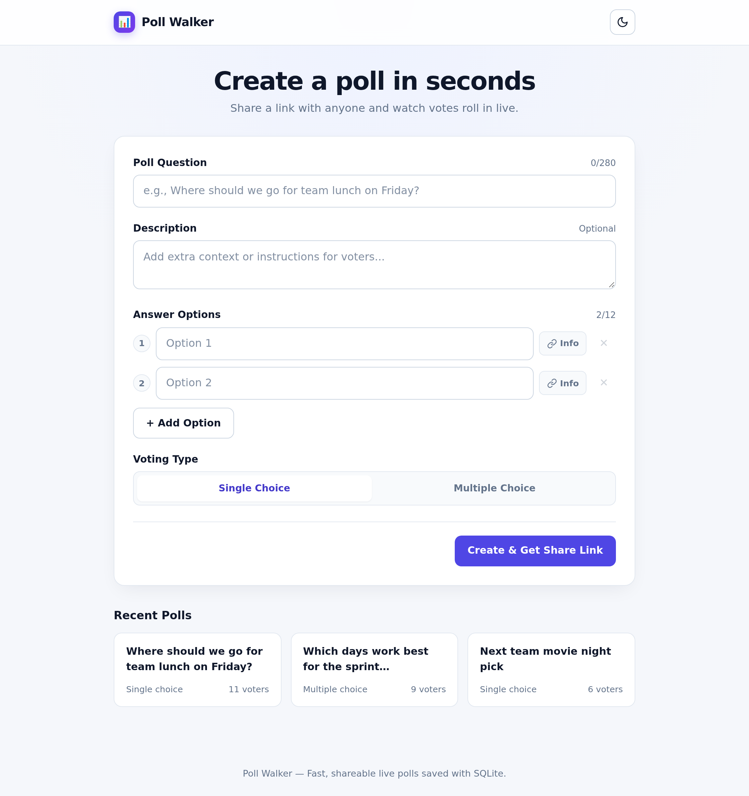
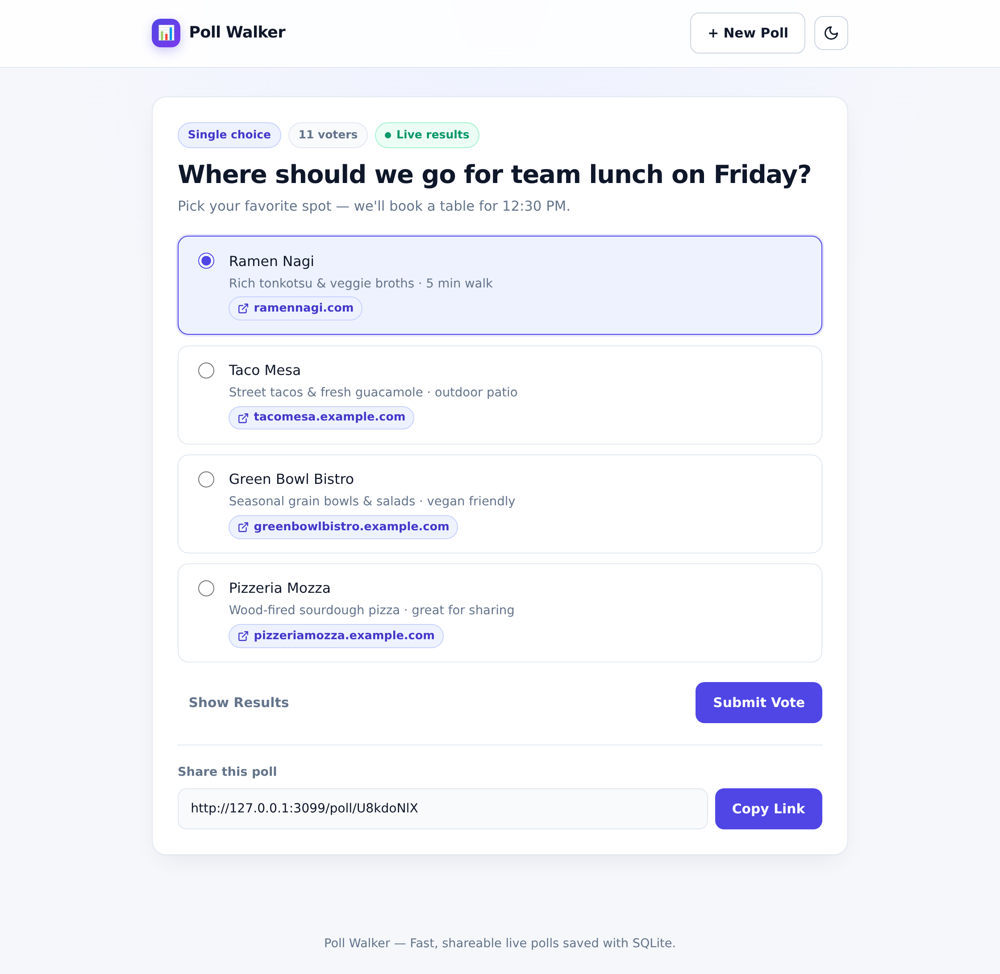
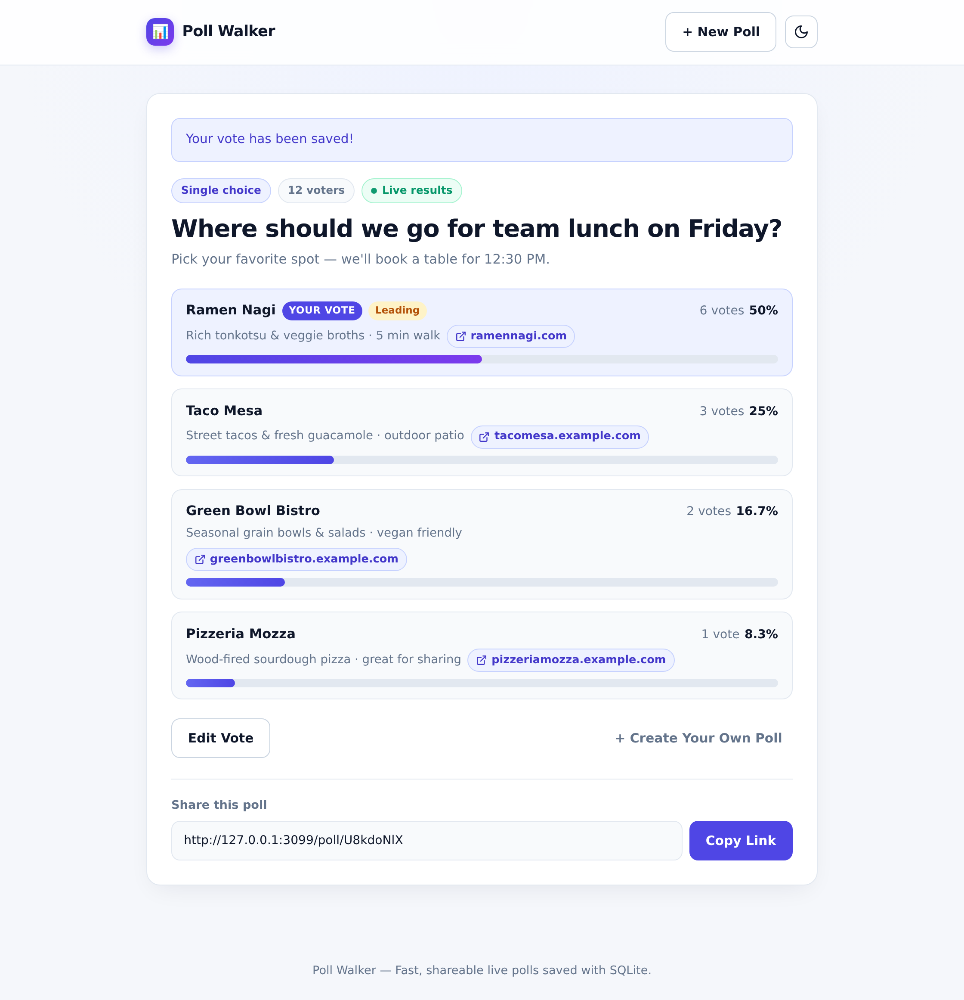
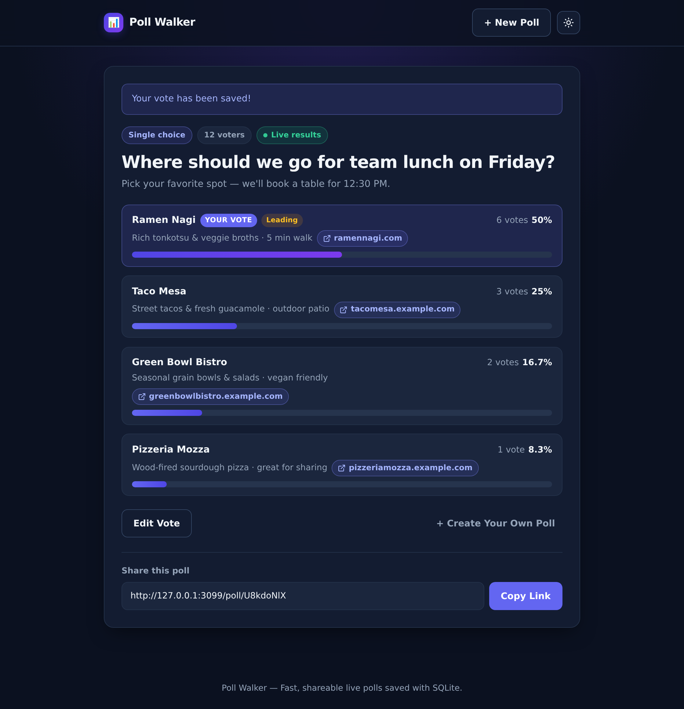

# Poll Walker

A fast, lightweight, self-hostable web app for creating and sharing live polls. Built with React, Express, Server-Sent Events (SSE), and Node's built-in SQLite driver — no external database or account setup required.

## Features

- **Instant Poll Creation** — Add a question, optional description, and 2–12 answer options.
- **Rich Answer Options** — Attach optional links (auto-normalized `http`/`https` URLs) and extra notes to any option.
- **Single & Multiple Choice** — Support both single-selection and multi-selection polls.
- **Live Results via SSE** — Vote counts and percentages stream to all connected viewers in real time.
- **Vote Editing & Deduplication** — Prevents duplicate votes using HTTP-only voter cookies and optional per-poll hashed IP deduplication, while still letting voters edit their vote later.
- **Easy Sharing** — Generates short shareable URLs (`/poll/:id`) with one-click copy and native Web Share API support.
- **Recent Polls** — Browse the most recently created polls right from the home page.
- **Light & Dark Mode** — Automatically follows your system theme with a manual toggle persisted in `localStorage`.

## Screenshots

### Create a Poll & Recent Polls


### Voting View


### Live Results (Light & Dark Mode)

| Light Mode | Dark Mode |
| :---: | :---: |
|  |  |

## Tech Stack

- **Frontend:** React 19, Vite 6
- **Backend:** Node.js (v24+), Express 5, `cookie-parser`, Server-Sent Events (SSE)
- **Database:** SQLite via Node's built-in `node:sqlite` (`DatabaseSync` with WAL mode)
- **Deployment:** Multi-stage Docker build + Nginx reverse proxy

## Getting Started

### Prerequisites

- **Local:** [Node.js](https://nodejs.org/) **24+** (or Node.js 22.5+ with `node:sqlite` support) and `npm`
- **Docker:** [Docker](https://www.docker.com/) and Docker Compose

### Option 1: Local Development

1. Install dependencies:
   ```bash
   npm install
   ```

2. Start both the Express API server and Vite dev server concurrently:
   ```bash
   npm run dev
   ```
   - **Frontend (Vite):** `http://localhost:5173` (proxies `/api` requests to the backend)
   - **Backend (Express):** `http://localhost:3001`

   You can also run them separately with `npm run dev:server` and `npm run dev:client`.

### Option 2: Local Production Build

Build the React frontend and serve everything from the Express server:

```bash
npm install
npm run build
npm start
```

The app will be available at `http://localhost:3001` (and on your LAN IP when `HOST=0.0.0.0`).

### Option 3: Docker Compose (Recommended for Self-Hosting)

The included `docker-compose.yml` runs Poll Walker behind an Nginx reverse proxy (pre-configured for SSE streaming and gzip) with a persistent Docker volume for the SQLite database.

1. (Optional) Create a `.env` file from the example to customize ports or IP deduplication:
   ```bash
   cp .env.example .env
   ```

2. Build and start the containers:
   ```bash
   docker compose up -d --build
   ```

3. Open `http://localhost` (or `http://localhost:<HTTP_PORT>` if customized).

To stop the stack:
```bash
docker compose down
```

## Configuration

Configure the server using environment variables (or `.env` when using Docker Compose):

| Variable | Default | Description |
| --- | --- | --- |
| `PORT` | `3001` | Port the Express server listens on. |
| `HOST` | `0.0.0.0` | Network interface to bind to. |
| `DB_PATH` | `./data/polls.db` | Path to the SQLite database file (`/app/data/polls.db` in Docker). |
| `ENFORCE_IP_DEDUP` | `true` | Deduplicate votes by hashed client IP in addition to cookies. Set to `false` for shared office/event Wi-Fi. |
| `HTTP_PORT` | `80` | *(Docker Compose)* Host port exposed by Nginx. |

## API Endpoints

| Method | Endpoint | Description |
| --- | --- | --- |
| `GET` | `/api/health` | Health check (`{ "status": "ok" }`). |
| `GET` | `/api/polls` | List the 12 most recent polls. |
| `POST` | `/api/polls` | Create a new poll. |
| `GET` | `/api/polls/:id` | Fetch a poll's details, results, and current voter state. |
| `POST` | `/api/polls/:id/vote` | Submit a vote. |
| `PUT` | `/api/polls/:id/vote` | Update an existing vote. |
| `GET` | `/api/polls/:id/stream` | Subscribe to live poll result updates via SSE. |

## Project Structure

```text
poll-walker/
├── server/
│   ├── index.js          # Express API, SSE broadcaster, and static file server
│   └── db.js             # SQLite schema, migrations, and query helpers
├── src/
│   ├── App.jsx           # Routing, theme toggle, and layout shell
│   ├── api.js            # Frontend API & EventSource helpers
│   ├── index.css         # Light/dark theme styles
│   └── components/
│       ├── CreatePoll.jsx
│       ├── PollView.jsx
│       └── RecentPolls.jsx
├── nginx/
│   └── default.conf      # Reverse proxy config with SSE streaming support
├── docs/screenshots/     # App screenshots for documentation
├── Dockerfile
├── docker-compose.yml
└── .env.example
```
